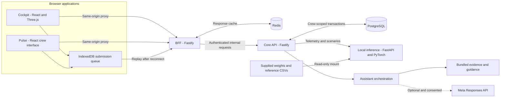
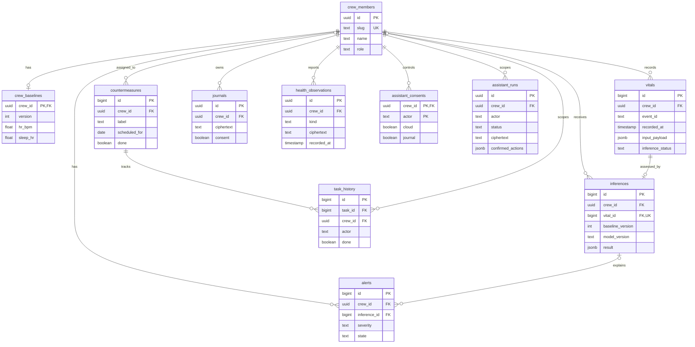
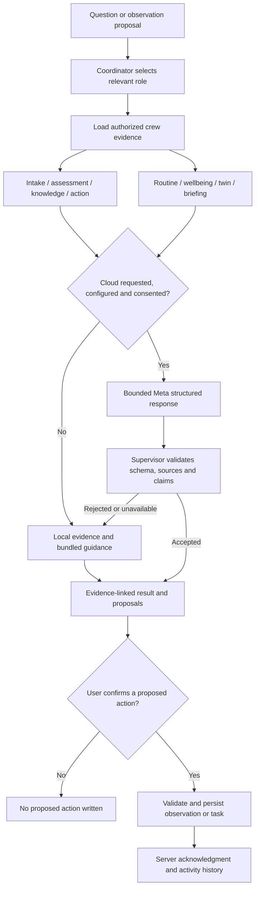
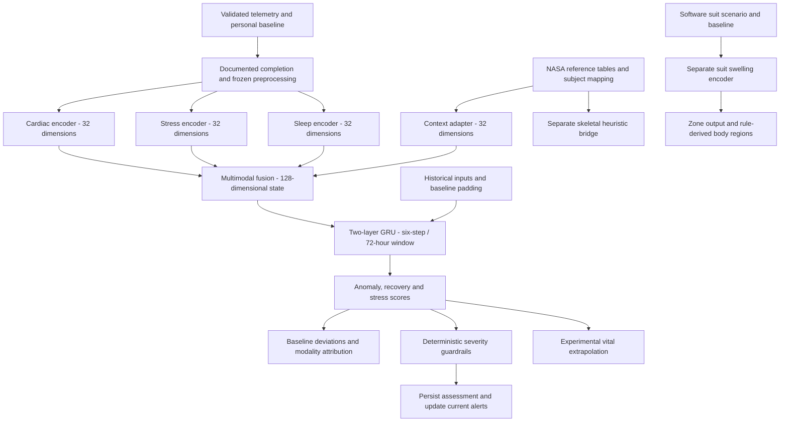

# A.V.I.A. — Autonomous Vital Intelligence Agent

**Crew health observations, local inference, and human-confirmed follow-up in one mission workspace.**

A.V.I.A. connects an operator dashboard (**Cockpit**) with a compact crew interface (**Pulse**). This software prototype compares observations with personal baselines, runs supplied pretrained models locally, explains available evidence, and tracks follow-up tasks.

## Contents

- [Implemented features](#implemented-features)
- [Inputs and data sources](#inputs-and-data-sources)
- [System architecture](#system-architecture)
- [Database design](#database-design)
- [Assistant and agent workflow](#assistant-and-agent-workflow)
- [Machine learning pipeline](#machine-learning-pipeline)
- [Quick start](#quick-start)
- [Local development](#local-development)
- [Verification](#verification)
- [Privacy and reliability](#privacy-and-reliability)
- [Operations](#operations)
- [Repository structure](#repository-structure)
- [Documentation and attribution](#documentation-and-attribution)

## Implemented features

| Workspace             | What is implemented                                                                                                     |
| --------------------- | ----------------------------------------------------------------------------------------------------------------------- |
| **Crew overview**     | Four fictional crew profiles, stored readings, assessment freshness, baseline comparisons, status and scheduled actions |
| **Alerts**            | Severity, evidence and baseline explanations; acknowledgment, resolution and action history                             |
| **Health assistant**  | Review-and-confirm observation intake, evidence-linked explanations, proposed tasks, routines and daily briefings       |
| **Digital Twin**      | Three.js anatomy layers, labeled suit-pressure scenarios and region-level results                                       |
| **Analytics**         | Timestamped history, accessible data tables and separately labeled experimental extrapolations                          |
| **Behavioral health** | Confirmed mood check-ins, recorded mood/sleep history, wellbeing guidance and owner-controlled journal sharing          |
| **Mission tools**     | Educational guide, CSV import, care tasks, encrypted journal, sync queue and activity history                           |
| **Pulse**             | Crew-specific dashboard, watch-style software interface, telemetry entry and shared backend records                     |

Both clients support responsive layouts and dark/light themes. Local inference and bundled guidance work without cloud AI; browser submissions can queue while the backend is unreachable.

## Inputs and data sources

Displayed readings are **software inputs**, not live sensor measurements:

1. **Manual entry:** users enter observations, units and UTC timestamps, then review and confirm them.
2. **CSV import:** historical telemetry is validated and imported through the ingestion workflow.
3. **Demo scenarios:** fictional seeded histories and labeled presets exercise the actual persistence and inference pipeline.

Model-supported telemetry includes heart rate, oxygen saturation, HRV, EDA, sleep duration and related fields. Missing values use documented carry-forward, baseline or reference rules and are identified as filled inputs. Additional blood-pressure, glucose, body-temperature, mood, nutrition, hydration and symptom observations are stored separately; they do not automatically become supported features of the pretrained models.

| Supplied reference material             | Role                                                            |
| --------------------------------------- | --------------------------------------------------------------- |
| BIDMC-derived features                  | Cardiac adapter preprocessing and reference evaluation          |
| WESAD-derived features                  | Stress adapter preprocessing and reference evaluation           |
| Sleep-EDF-derived features              | Sleep preprocessing, reference profiles and evaluation          |
| NASA CBC and OSD-919 tables             | Reference biological context and a disclosed skeletal heuristic |
| Suit feature table                      | Suit preprocessing and reference evaluation                     |
| NASA HRP, MedlinePlus and FDA resources | Linked educational guidance, separate from model datasets       |

NASA context is reference data, not a current blood test of the fictional crew. Bundled CSVs are supplied derivatives; this repository does not establish their complete upstream derivation or the checkpoints' training history. See the [dataset-use audit](doc/submission/DATASET-USE-AUDIT-2026-11-13.md).

## System architecture



The BFF is the clients' API boundary. It authorizes operator/crew requests, aggregates responses and caches Cockpit views. The core owns validation, persistence, model requests and alert transitions. The inference service runs on the host CPU in its own container, rather than inside the browser or watch interface.

See [architecture and API boundaries](doc/architecture.md) for routes and transaction behavior.

## Database design

PostgreSQL migrations define the schema. This diagram shows principal entities, selected columns and actual foreign-key relationships.



Supporting tables hold mission configuration (`mission`), mutation audit records (`activity_history`), seed anchors (`seed_anchors`) and applied migrations (`schema_migrations`). Mission configuration and activity records have no foreign-key relationship to the crew roster.

Crew-scoped tables use row-level security where configured in the [SQL migrations](server/migrations/). The API uses a non-superuser database role and sets `app.crew_id` within scoped transactions. Application authorization also controls crew identities and mission-wide resources. Journal content, additional observations and assistant history use AES-256-GCM encryption.

## Assistant and agent workflow

The assistant implements **ten logical roles in one bounded orchestration service**, rather than ten independent models: coordinator, intake, assessment, knowledge, action, routine, wellbeing, twin, briefing and supervisor.



The supervisor checks structure, evidence IDs, unsupported claims and action boundaries; it cannot guarantee medical correctness. Cloud processing is optional. Journal processing requires separate owner consent and explicit entry selection. Unavailable or rejected cloud output falls back to local guidance.

Implementation: [assistant reference](doc/AGENT-DELIVERY.md), [orchestrator](server/src/services/assistant.ts), [knowledge library](server/src/services/knowledge.ts) and [provider adapter](server/src/services/muse.ts).

## Machine learning pipeline

Five supplied checkpoints are retained unchanged: cardiac, stress, sleep, temporal fusion and suit swelling. NASA context is constructed from reference tables. No new training or fine-tuning is required.



| Component                          | Output and boundary                                                                                             |
| ---------------------------------- | --------------------------------------------------------------------------------------------------------------- |
| Cardiac, stress and sleep encoders | Scores/embeddings from supplied adapters; manual-feature approximations are disclosed                           |
| Fusion and temporal engine         | Anomaly, recovery and stress outputs; runtime architecture reconstructed from checkpoints and handoff documents |
| Explanations                       | Baseline deviations and counterfactual modality contributions; not causal explanations of disease               |
| Vital extrapolation                | Added experimental formula, without independent validation                                                      |
| Suit/body regions                  | Experimental model output plus arithmetic and threshold rules                                                   |
| Skeletal projection                | Reference-informed heuristic, not measured bone density                                                         |

Startup verifies checksums and restores frozen preprocessing. Reference-row evaluation establishes reproducibility on supplied files with possible training overlap; it does not establish independent predictive or clinical accuracy. Details: [inference service](agent/README.md), [model card](agent/MODEL-CARD.md) and [evaluation scope](doc/evaluation/README.md).

## Quick start

**Requirement:** Docker with Docker Compose. The first build downloads images and dependencies. CPU inference is supported; neither a GPU nor a cloud API key is required.

```bash
git clone https://github.com/feedofmri/A.V.I.A..git
cd A.V.I.A.
docker compose up -d --build
```

Defaults support a localhost demonstration. To customize configuration, copy [.env.example](.env.example) to `.env` before starting.

Startup applies migrations, loads the models and idempotently seeds fictional histories through the real inference pipeline. Wait for `seed complete`:

```bash
docker compose ps
docker compose logs seed --tail 20
```

| Service          | Local address                                                       |
| ---------------- | ------------------------------------------------------------------- |
| Cockpit          | [localhost:8080](http://localhost:8080)                             |
| Pulse            | [localhost:8081](http://localhost:8081)                             |
| BFF health       | [localhost:4000/health](http://localhost:4000/health)               |
| Core health      | [localhost:3000/health](http://localhost:3000/health)               |
| Inference health | [localhost:8000/api/v1/health](http://localhost:8000/api/v1/health) |

### Demo accounts

| Username                           | Password             | Access                                                                                   |
| ---------------------------------- | -------------------- | ---------------------------------------------------------------------------------------- |
| `operator`                         | `avia-demo-operator` | Crew dashboard, assessments, tasks, mission configuration and explicitly shared journals |
| `okafor`, `brandt`, `sato`, `diaz` | `avia-demo-crew`     | The signed-in crew member's own workspace                                                |

Use **separate browser profiles/private contexts** for concurrent identities: localhost ports share cookies within one browser context. Start with Overview, Health assistant or Mission tools. Crew accounts can open Behavioral health in Cockpit.

Before shared deployment, configure `DEMO_MODE=false`, `AUTH_USERS`, independent random `INTERNAL_API_TOKEN` and `JOURNAL_KEY` values, allowed origins, HTTPS and secure cookies. Keep the journal key with protected backup material. Demo accounts and default secrets are for local use.

## Local development

Use Node.js 24, Python 3.12 and Docker for PostgreSQL/Redis. Install root dependencies as well as the four application packages:

```bash
npm ci
npm run install:all
python -m pip install -r agent/requirements-dev.txt
npm run infra:up
npm run db:migrate
```

Start each long-running service in a separate terminal:

```bash
npm run dev:agent       # localhost:8000
npm run dev:server      # localhost:3000
npm run dev:bff         # localhost:4000
npm run dev:cockpit     # localhost:5173
npm run dev:pulse       # localhost:5174
```

Once inference is ready, run `npm run db:seed`. Vite proxies requests to the BFF. Stop conflicting Docker application services before starting local equivalents on the same ports.

Optional cloud explanations require `MODEL_API_KEY` and `META_MODEL` in the **server environment**, plus saved in-app consent. Compose reads `.env` automatically; local development processes need those variables supplied in their shell environment. Never put provider credentials in frontend configuration.

## Verification

For complete isolated verification:

```bash
npm ci
npm run install:all
npx playwright install chromium
npm run test:platform
```

The runner builds a separate `avia-platform-test` stack with disposable volumes and generated credentials. It tests inference recovery without stopping the normal demo stack. Reports and screenshots go under ignored `state/`.

| Command                   | Scope                                                                |
| ------------------------- | -------------------------------------------------------------------- |
| `npm run build:all`       | Core API, BFF and both production clients                            |
| `npm run test:server`     | Core unit tests                                                      |
| `npm run test:agent`      | Actual weights/reference files; local Python dependencies required   |
| `npm run test:ui-unit`    | CSV/platform unit checks                                             |
| `npm run test:e2e`        | Running seeded BFF/database/inference workflows; writes demo records |
| `npm run test:regression` | Platform API regressions; use the isolated environment               |
| `npm run test:browser`    | Browser workflows; defaults target isolated Cockpit on port 28080    |

The [dated test report](doc/TEST-REPORT-2026-11-12.md) records its revision and scope, rather than certifying every subsequent checkout. [GitHub Actions](.github/workflows/platform.yml) runs verification and uploads selected reports. Live-provider checks are separate, explicitly enabled operations.

## Privacy and reliability

- **Access:** expiring HttpOnly sessions, operator/crew authorization, internal API token and crew-scoped transactions.
- **Consent:** owner-controlled journal sharing; separate cloud and journal-processing consent.
- **Durability:** user-scoped IndexedDB outbox, stable event IDs, conflict checks and replay-safe writes.
- **Recovery:** telemetry commits before inference; a durable worker retries pending assessments.
- **Currentness:** timestamps, baseline versions, provenance and filled-field indicators accompany evidence. Old readings are not treated as current assessments.
- **Auditability:** alert transitions, task completion and confirmed actions retain history.

Offline browser entry requires an already loaded/cached application; backend reconnection is necessary to synchronize. Local models require the local backend and inference service to be running. Optional cloud failure does not disable those services.

## Operations

| Command                                | Purpose                                                                               |
| -------------------------------------- | ------------------------------------------------------------------------------------- |
| `docker compose up -d --build`         | Build/start and apply migrations                                                      |
| `docker compose down`                  | Stop services while retaining data volumes                                            |
| `npm run backup`                       | Database dump to ignored `state/backups/`                                             |
| `npm run demo:reset -- --confirm-demo` | Regenerate seed readings/alerts; preserve user entries and journals                   |
| `npm run offline:export`               | Package built images, artifacts and configuration for another Docker-equipped machine |

Keep `.env`, database dumps, journal data and generated secrets out of Git. Restoring encrypted content requires the original `JOURNAL_KEY`. See the [operations guide](doc/SOFTWARE-DELIVERY.md#backup-reset-and-offline-distribution).

## Repository structure

```text
AVIA/
├── client-cockpit/       Operator dashboard, 3D twin and behavioral workspace
├── client-pulse/         Crew dashboard and watch-style software interface
├── bff/                  Client API, authentication and response cache
├── server/               Core API, assistant orchestration and persistence
│   └── migrations/       PostgreSQL schema, indexes and RLS policies
├── agent/                FastAPI/PyTorch inference, model card and tests
│   └── artifacts/        Integrity manifest and frozen preprocessing
├── model files/          Supplied checkpoints, adapters and reference CSVs
├── docker/               Database role initialization
├── scripts/              Tests, recording, backup and offline export
├── doc/                  Architecture, features, evidence and submission references
├── .github/workflows/    Automated verification
└── docker-compose.yml    Local deployment and service dependencies
```

The active ML runtime is `agent/`. Artifacts are mounted read-only; do not edit them to bypass integrity verification.

## Documentation and attribution

| Reference                                                           | Contents                                                               |
| ------------------------------------------------------------------- | ---------------------------------------------------------------------- |
| [Architecture](doc/architecture.md)                                 | API boundaries, ingestion/recovery, storage and ports                  |
| [Feature and operations guide](doc/SOFTWARE-DELIVERY.md)            | Features, UI/behavioral guidance, walkthrough, verification and backup |
| [Assistant reference](doc/AGENT-DELIVERY.md)                        | Roles, provider integration, privacy and confirmed actions             |
| [Inference service](agent/README.md)                                | Endpoints, artifacts and runtime decisions                             |
| [Model card](agent/MODEL-CARD.md)                                   | Reconstruction, preprocessing and validation limits                    |
| [Evaluation scope](doc/evaluation/README.md)                        | Reference-row results and provider regression evidence                 |
| [Test report](doc/TEST-REPORT-2026-11-12.md)                        | Dated results and coverage                                             |
| [Dataset-use audit](doc/submission/DATASET-USE-AUDIT-2026-11-13.md) | Supplied-file usage and provenance boundaries                          |
| [Project summary](doc/submission/PROJECT.md)                        | Problem, contribution, existing work and intended impact               |
| [Submission references](doc/submission/)                            | Prepared form, pitch and external readiness questions                  |

The supplied checkpoints, adapters and reference data predate this implementation. Fusion reconstruction and manual-feature approximations are disclosed in the model card. Development used AI coding assistance. Original technical handoff documents remain under `doc/` for provenance.

Educational guidance links to [NASA hazards](https://www.nasa.gov/hrp/hazards/), [NASA research risks](https://www.nasa.gov/hrp/risks/), [MedlinePlus vital signs](https://medlineplus.gov/vitalsigns.html) and [FDA pulse oximeter limitations](https://www.fda.gov/medical-devices/products-and-medical-procedures/pulse-oximeters).

No NASA endorsement or blanket redistribution license is claimed. Dataset, derivative and model rights require confirmation with their respective owners. Software tests do not establish clinical safety or medical effectiveness.
